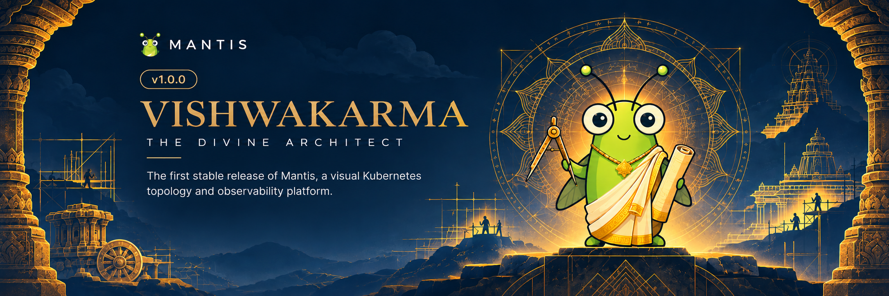
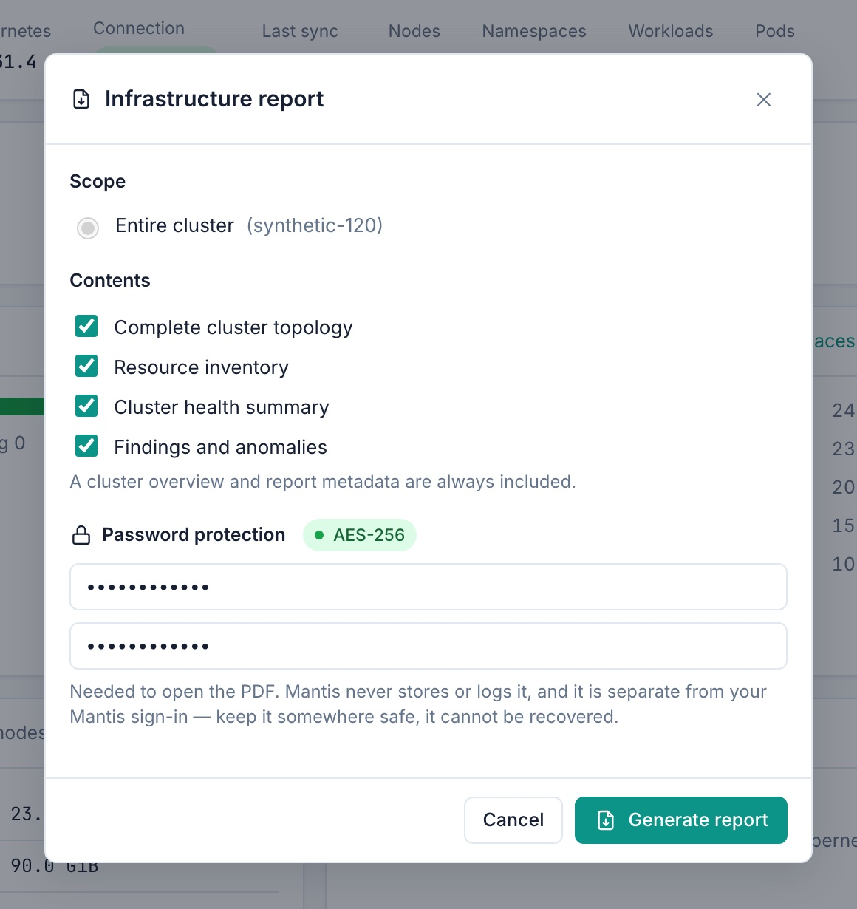
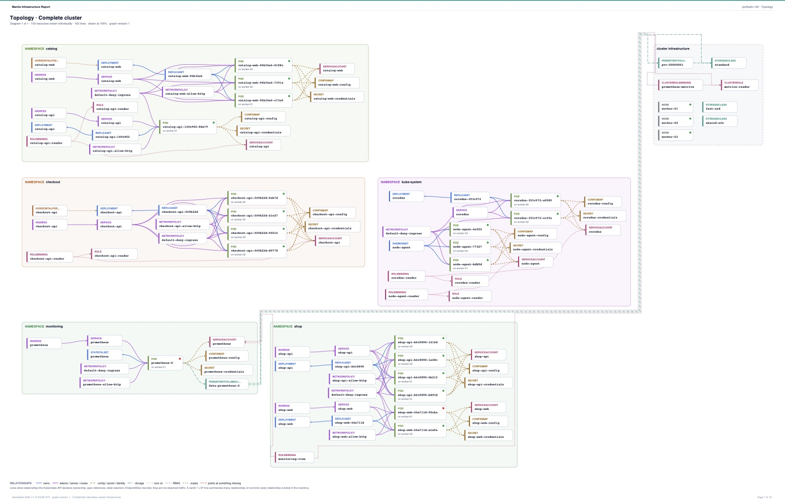

<!--
GitHub Release body for v1.0.0.
Title: VISHWAKARMA – THE DIVINE ARCHITECT
Publish (after the v1.0.0 tag exists):
  gh release create v1.0.0 --repo continuumx1/mantis \
    --title "VISHWAKARMA – THE DIVINE ARCHITECT" \
    --notes-file .github/releases/v1.0.0.md \
    docs/images/releases/mantis-v1.0.0-vishwakarma.png
-->



# Mantis v1.0.0 – Vishwakarma

**The Divine Architect** · the first stable release of Mantis, a visual
Kubernetes topology and observability platform.

*Every great creation begins with a vision. Every extraordinary structure
begins with an architect.*

In Indian tradition, Vishwakarma is the divine architect and master
craftsman. Engineers, architects and artisans still honour him by
celebrating the tools of their trade. Mantis is a tool for builders, so our
first stable release carries his name, dedicated *to the engineers,
architects and open-source builders who create the invisible foundations of
our digital world.*

Read the full story on the [release page](https://mantis.continuumx1.com/releases/v1.0.0).

## Highlights

- **Deterministic topology** — Namespace, Node, Workload and Dependency
  views (1–3 hops), laid out the same way every time with no overlapping
  cards or lines; namespace summary cards and folded stacks for large
  clusters.
- **Typed, verified relationships** — ownership, networking, configuration,
  storage, security and autoscaling, each with the field it came from;
  dangling references drawn as dashed red lines.
- **Application UI** — dashboard, resource tables and details (YAML, events,
  conditions, related resources), global search (`Ctrl K`), light and dark
  themes.
- **Live, watch-based sync** — one list per kind, then Kubernetes watches;
  the UI fetches only what changed (`/api/graph?since=`).
- **Download reports** — one click (**Download report** on the dashboard,
  account menu or Topology toolbar) produces a password-protected PDF
  (AES-256, PDF 2.0 R6) with topology diagrams, inventory, health and
  findings, built by the new `mantis-report` service.
- **Secure sign-in** — no default password: the chart generates one, stored
  only as a bcrypt hash; failed sign-ins throttled; `Secure` cookies over
  HTTPS.

<p align="center">
  
  
</p>

## Install

```bash
helm install mantis oci://registry-1.docker.io/cx1tech/mantis \
  --version 1.0.0 --namespace mantis --create-namespace

kubectl port-forward -n mantis svc/mantis-web 8081:8080
kubectl get secret mantis-admin -n mantis -o jsonpath='{.data.password}' | base64 -d; echo
```

Open http://localhost:8081 and sign in as `admin`.

Images (multi-arch, `linux/amd64` + `linux/arm64`):
`cx1tech/mantis:1.0.0-engine`, `cx1tech/mantis:1.0.0-web`,
`cx1tech/mantis:1.0.0-report`.

## Upgrading from 0.3.0

```bash
helm upgrade mantis oci://registry-1.docker.io/cx1tech/mantis \
  --version 1.0.0 --namespace mantis --reset-then-reuse-values
```

- Use `--reset-then-reuse-values` (Helm 3.14+) or your values file; plain
  `--reuse-values` keeps the 0.3.0 values, which lack `auth` and `report`.
- The `admin`/`admin` login is removed. Read the generated password from the
  Secret named in the install notes, or set `auth.adminPassword`.
- RBAC adds the read-only `watch` verb and `list` on `events` and
  `metrics.k8s.io` `nodes`. No write verbs.

## Full changelog

See [CHANGELOG.md](https://github.com/continuumx1/mantis/blob/v1.0.0/CHANGELOG.md)
for every change since 0.3.0, and the
[documentation](https://continuumx1.github.io/mantis/) for setup, security
and architecture.

## Contributors

Built by [ContinuumX1 Technologies](https://continuumx1.com), with
contributions from @gokulsrinivasb. Thank you to everyone who tried the
Public Preview and shared feedback on [Discord](https://discord.gg/ZTB4eGfCxa).
