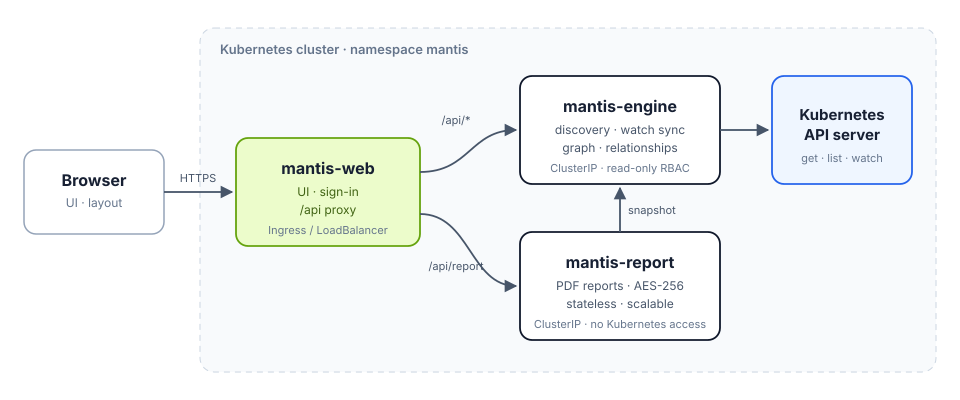
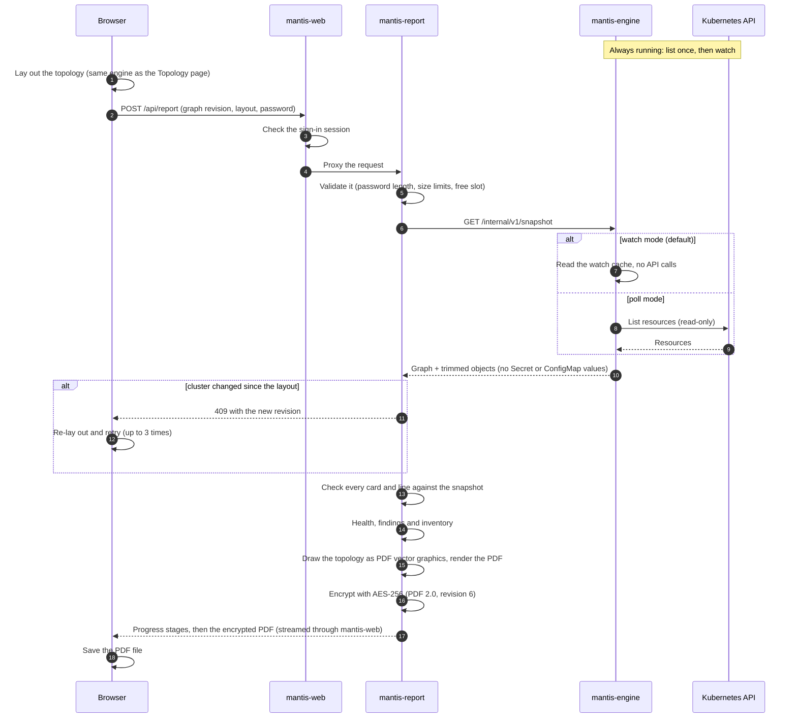

<p align="center">
  
</p>
<p align="center">
  
</p>

<h1 align="center">Mantis — Visual Kubernetes Topology, No Guesswork</h1>

<p align="center">
  <a href="https://github.com/continuumx1/mantis/releases/tag/v1.0.0"></a>
  <a href="LICENSE"></a>
</p>

<p align="center"><em>Connect all the dots in your cluster.</em></p>

<p align="center">
  <a href="https://discord.gg/ZTB4eGfCxa"><strong>💬 Join the Discord</strong></a>
  ·
  <a href="https://continuumx1.github.io/mantis/">📖 Docs</a>
</p>

Mantis is an open-source Kubernetes context and investigation tool with an
interactive web UI. Point it at a cluster and it discovers how your resources
relate to each other, and draws that as a live, explorable graph — so you see
not just *what* exists, but the *story* connecting it.

**Mantis 1.0** is the first stable release:

- **Topology** — deterministic, overlap-free graph views by namespace, node,
  workload and dependency, with typed, verified relationships.
- **Application UI** — dashboard, resource tables and details, events,
  capacity and a needs-attention list.
- **Live** — the engine follows the cluster with Kubernetes watches; the UI
  receives only what changed.
- **Infrastructure reports** — export the cluster as a password-protected
  (AES-256) PDF with topology diagrams, inventory, health and findings.
- **Secure by default** — strictly read-only, Secret values never fetched,
  and sign-in with a password you configure (no default password).

See the [changelog](CHANGELOG.md) for everything that changed since 0.3.0.

Built and maintained by [ContinuumX1 Technologies](https://continuumx1.com).

---

## Why Mantis?

Kubernetes tells you *what* exists. A `Pod` has an `ownerReferences` field, a
`Service` has a `selector`, an `Ingress` has a `backend` — but you have to hold
all of that in your head and stitch it together yourself to answer everyday
questions:

- Why does this pod exist, and what created it?
- Which pods does this service actually route to?
- This pod is stuck `Pending` — what is it waiting on?
- This ingress returns 503 — does the service it points at even exist?

Mantis turns raw metadata into an explained, linked graph: every resource is a
node, every relationship is a typed edge, and namespaces are drawn as regions.
References that point at something which doesn't exist are flagged, not
hidden — Mantis checks, it doesn't guess.

## What makes it different

Mantis isn't trying to replace the tools you already use — it solves a
different problem.

| Tool | Its job | Mantis's job |
|------|---------|-----------|
| `kubectl` | Query and mutate resources | Explain how resources relate |
| k9s | Interactive cluster navigation | Context and investigation |
| Prometheus / Grafana | Metrics and dashboards | Relationships, not metrics |
| ArgoCD | "Does live match Git?" (GitOps sync) | "What's the story around this resource?" |

Mantis works on **any** resource whether or not it was deployed through a
pipeline, is strictly **read-only** — it never mutates your cluster — and
runs on **any** Kubernetes distribution (minikube, kind, kubeadm, RKE2, EKS,
GKE, AKS, …) because it talks to the standard Kubernetes API, never to a
specific distro.

## How it works

Mantis runs as **three small services** — `mantis-web`, `mantis-engine` and
`mantis-report` — plus your browser. There is no database and no extra
storage. Every graph you see is built from the engine's live view of the
Kubernetes API.

<p align="center">
  
</p>

1. Your browser loads the UI from **`mantis-web`** and signs in.
2. The page asks `mantis-web` for the graph; `mantis-web` proxies that
   straight to **`mantis-engine`** — your browser never talks to the engine
   or to Kubernetes directly.
3. `mantis-engine` reads the cluster (via its Pod's ServiceAccount, or your
   kubeconfig when run locally), follows changes with Kubernetes watches,
   resolves relationships between what it finds, and returns a compact JSON
   graph.
4. The UI lays it out and asks only for what changed on an interval you
   control (10 seconds by default, or manual).
5. **Download report** asks **`mantis-report`** (via `mantis-web`) for a
   password-protected PDF [Infrastructure Report](docs/reports.md). It reads
   one snapshot from the engine's internal API, so it never talks to
   Kubernetes and can be scaled on its own.

<details>
<summary>How a report is generated</summary>



</details>

Because only `mantis-web` needs to be reachable, `mantis-engine` and
`mantis-report` stay private, internal-only services.

```
cmd/
  mantis-engine/      backend service entry point (main.go)
  mantis-web/         frontend service entry point (main.go)
  mantis-report/      report service entry point (main.go)
internal/
  graph/              relationship model — ResourceRef, typed Relation,
                       resolvers, Context, and the whole-cluster graph builder
  engine/              backend: graph JSON projection (dto.go) + HTTP handlers
                       (server.go): /api/graph, /api/resource, /healthz, /readyz
  snapshotapi/         internal engine → report snapshot contract
  report/              report service: health, findings, PDF rendering, AES-256
  web/                 frontend: embedded UI, login gate, /api reverse-proxy
    ui/                the interactive graph (single-page, no external assets)
  kubernetes/          read-only client (in-cluster ServiceAccount OR kubeconfig)
  httpx/               shared HTTP serving (graceful shutdown, env config)
build/
  Dockerfile.engine    backend image (distroless, nonroot)
  Dockerfile.web       frontend image (distroless, nonroot)
  Dockerfile.report    report image (distroless, nonroot)
```

For the full picture — every UI feature, the security/permissions model, and
troubleshooting — see the **[docs site](https://continuumx1.github.io/mantis/)**.

## Quick start (run it on your own machine)

**Requirements:** Go 1.26+, and a Kubernetes cluster your `kubectl`/kubeconfig
already works against — any distribution (minikube, kind, a real cluster,
whatever you've got).

```bash
git clone https://github.com/continuumx1/mantis.git
cd mantis

# 1. Backend — reads your cluster via your local kubeconfig, no setup needed
MANTIS_ENGINE_ADDR=":8080" go run ./cmd/mantis-engine

# 2. Reports — in a second terminal
MANTIS_REPORT_ADDR=":8082" MANTIS_ENGINE_URL="http://localhost:8080" go run ./cmd/mantis-report

# 3. Frontend — in a third terminal, serves the UI and proxies /api
MANTIS_WEB_ADDR=":8081" MANTIS_ENGINE_URL="http://localhost:8080" \
  MANTIS_REPORT_URL="http://localhost:8082" \
  MANTIS_ADMIN_PASSWORD='choose-a-password' go run ./cmd/mantis-web
```

Then open **<http://localhost:8081>** and sign in as `admin` with the
password you chose. You land on the dashboard of whatever cluster your
kubeconfig points at; **Topology** shows the relationship graph, and
**Ctrl K** searches everything.

Nothing here is cluster-specific — both ports, and the `localhost` URL, are
just this example; use whatever's free on your machine.

## Configuration

All three services are configured entirely through environment variables.

| Service | Env var | Default | Meaning |
|---------|---------|---------|---------|
| `mantis-engine` | `MANTIS_ENGINE_ADDR` | `:8080` | listen address |
| `mantis-engine` | `MANTIS_SHOW_ALL` | `false` | include system-managed ConfigMaps/Secrets |
| `mantis-engine` | `MANTIS_SYNC_MODE` | `watch` | `watch` (list once, then follow changes) or `poll` |
| `mantis-engine` | `MANTIS_SYNC_INTERVAL` | `20s` | poll mode only: re-list interval |
| `mantis-web` | `MANTIS_WEB_ADDR` | `:8080` | listen address |
| `mantis-web` | `MANTIS_ENGINE_URL` | `http://mantis-engine:8080` | engine base URL to proxy `/api` to |
| `mantis-web` | `MANTIS_REPORT_URL` | *(empty)* | report service URL for `/api/report`; empty disables reports |
| `mantis-web` | `MANTIS_ADMIN_USERNAME` | `admin` | administrator account name |
| `mantis-web` | `MANTIS_ADMIN_PASSWORD_HASH` | — | bcrypt hash of its password (preferred) |
| `mantis-web` | `MANTIS_ADMIN_PASSWORD` | — | or the password itself (8+ characters); one of the two is required |
| `mantis-report` | `MANTIS_REPORT_ADDR` | `:8080` | listen address |
| `mantis-report` | `MANTIS_ENGINE_URL` | `http://mantis-engine:8080` | engine base URL for snapshots |
| `mantis-report` | `MANTIS_REPORT_MAX_CONCURRENT` | `2` | simultaneous reports per replica |

Endpoints:

- `mantis-engine`: `GET /api/graph` (`?since=` for deltas), `GET /api/graph/search`, `GET /api/graph/neighbors`, `GET /api/resource`, `GET /api/events`, `GET /api/cluster/capacity`, `GET /api/sync/status`, `GET /internal/v1/snapshot` (for `mantis-report` only), `GET /healthz`, `GET /readyz`
- `mantis-web`: `GET /` (UI), `GET`/`POST /login`, `POST /logout`, `GET /api/session`, `/api/*` (proxied to the engine), `POST /api/report` (proxied to `mantis-report`), `GET /healthz`
- `mantis-report`: `POST /api/report` (NDJSON progress, then the encrypted PDF), `GET /healthz`, `GET /readyz`

## Running in a cluster

```bash
# No clone needed — the chart is published too:
helm install mantis oci://registry-1.docker.io/cx1tech/mantis \
  --version 1.0.0 --namespace mantis --create-namespace

# or, from a checkout of this repo:
helm install mantis ./charts/mantis --namespace mantis --create-namespace
```

The **[Helm chart](charts/mantis)** deploys all three services:
`mantis-engine` with the read-only ClusterRole/ClusterRoleBinding it needs
(exposed only as a `ClusterIP`, never publicly), `mantis-report` (no
Kubernetes access at all), `mantis-web` pointed at both, a Secret with the
administrator account, and everything that goes with them (probes,
security contexts, optional network policies and Ingress).

Sign in as `admin`. Unless you set `auth.adminPassword`, the chart
generates a password; read it with:

```bash
kubectl get secret mantis-admin -n mantis \
  -o jsonpath='{.data.password}' | base64 -d; echo
```

 Images pull straight from
[`cx1tech/mantis`](https://hub.docker.com/r/cx1tech/mantis) on Docker Hub
by default — multi-arch (`linux/amd64` + `linux/arm64`), built from a
distroless nonroot base, no local build required. See
**[charts/mantis/README.md](charts/mantis/README.md)** for exposing it
(Ingress/LoadBalancer/port-forward), available chart versions, and the
full values reference. Full detail on the required permissions and the
security model is on the **[docs site](https://continuumx1.github.io/mantis/)**.

Images were tagged `0.1.0-preview.1` through `0.1.0-preview.3` during the
Public Preview; `1.0.0` is the current, stable image and chart version.

Building from source is still one command away if you're working on
Mantis itself — each service has its own multi-stage, distroless,
nonroot Dockerfile:

```bash
docker build -f build/Dockerfile.engine -t cx1tech/mantis:dev-engine .
docker build -f build/Dockerfile.web    -t cx1tech/mantis:dev-web .
docker build -f build/Dockerfile.report -t cx1tech/mantis:dev-report .
```

## Relationship model

Relationships are named for their **Kubernetes semantics**, not for
convenience.

| Relationship | Meaning | Source |
|--------------|---------|--------|
| `controlled-by` | A resource is controlled by its owner | `ownerReferences` |
| `runs-on` | A Pod is scheduled onto a Node | `pod.spec.nodeName` |
| `selects` | A Service selects Pods | `service.spec.selector` |
| `serves` | A Service actually backs a Pod | EndpointSlices |
| `routes-to` | An Ingress routes to a Service | ingress backends |
| `references` | A Pod consumes config via the environment | `env` / `envFrom` |
| `mounts` | A Pod mounts config as a volume | `volumes` |
| `claims` | A Pod claims a PersistentVolumeClaim | `volumes[].persistentVolumeClaim` |
| `bound-to` | A PVC is bound to a PersistentVolume | `pvc.spec.volumeName` |
| `scales` | An HPA/VPA drives a workload's replicas or resources | `scaleTargetRef` / `targetRef` |
| `uses-service-account` | A Pod runs as a ServiceAccount | `pod.spec.serviceAccountName` |
| `storage-class` | A PVC or PV uses a StorageClass | `spec.storageClassName` |
| `binds-role` | A (Cluster)RoleBinding grants a Role or ClusterRole | `roleRef` |
| `grants-to` | A (Cluster)RoleBinding grants its role to a ServiceAccount | `subjects` |
| `applies-to` | A NetworkPolicy selects a Pod | `spec.podSelector` |

A key principle: Mantis distinguishes **facts** it read from the API from
references it couldn't verify. A target that was checked and found missing
is shown as a "not found" node; one that exists is shown plainly.

## Current limitations

- **One administrator account.** Everyone signed in sees what the engine's
  ServiceAccount can read; multiple users, roles, SSO and per-user,
  RBAC-aware visibility are planned. For SSO today, put Mantis behind an
  authenticating proxy.
- **Built-in kinds, plus two specific CRDs.** VerticalPodAutoscaler and
  Karpenter's NodePool are understood specifically (best-effort, only if
  installed); other custom resources and the Gateway API aren't mapped yet.
- **No change/history/GitOps awareness** — Mantis explains current state,
  not what changed or why.

## Roadmap

**Current (1.0)**
- Relationship engine with typed, evidence-classified relationships
- Deterministic topology: namespace, node, workload and dependency views
- Application UI: dashboard, resource tables and details, events, capacity
- Watch-based sync with incremental updates (poll fallback)
- Password-protected PDF infrastructure reports (`mantis-report`)
- Configurable administrator sign-in (bcrypt, no default password)
- Helm chart (three services, read-only RBAC, network policies)
- Published multi-arch images on Docker Hub (`cx1tech/mantis`)

**Planned**
- Multiple users and roles, OIDC single sign-on, audit log
- Per-user, RBAC-aware visibility
- Gateway API resources
- Scheduled reports

**Future**
- Change detection and correlation (Git, GitOps, Helm)
- Broader custom resource (CRD) support

Priorities evolve from real use; nothing above is a commitment.

## Development

```bash
go build ./...       # build all services
go test ./...        # Go tests
node --test test/ui/*.test.js  # UI layout tests (Node 20+)
go vet ./...       # static checks
gofmt -l .         # formatting (should print nothing)
```

Relationship resolution is the core logic and is covered by unit tests using
a fake Kubernetes client, so most behavior can be verified without a live
cluster.

## Contributing & community

Contributions are welcome — this project is being opened up for
collaborators, and early feedback shapes it directly. A good place to start:

- **[Join the Discord](https://discord.gg/ZTB4eGfCxa)** — ask questions,
  report what's confusing or broken, or talk through an idea before you
  build it. This is the fastest way to reach the maintainers.
- Read the **[docs site](https://continuumx1.github.io/mantis/)** first —
  it covers how Mantis works end-to-end, which answers most "how does X
  work" questions before you need to read code.
- Keep PRs small and focused, follow [Conventional Commits](https://www.conventionalcommits.org/),
  and include tests for new relationship logic (see `internal/graph`'s
  existing tests for the pattern — they use a fake Kubernetes client, so no
  real cluster is needed to contribute).

Formal contribution and security-reporting guidelines will be added as the
project grows; until then, the Discord is the place to ask.

## License

Mantis is licensed under the [Apache License 2.0](LICENSE).

Copyright 2026 ContinuumX1 Technologies Private Limited.

The Mantis name, logo, and mascot are trademarks of ContinuumX1 Technologies
and are not covered by the software license. See [NOTICE](NOTICE).
