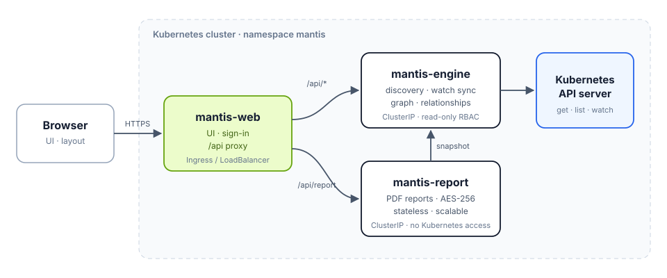
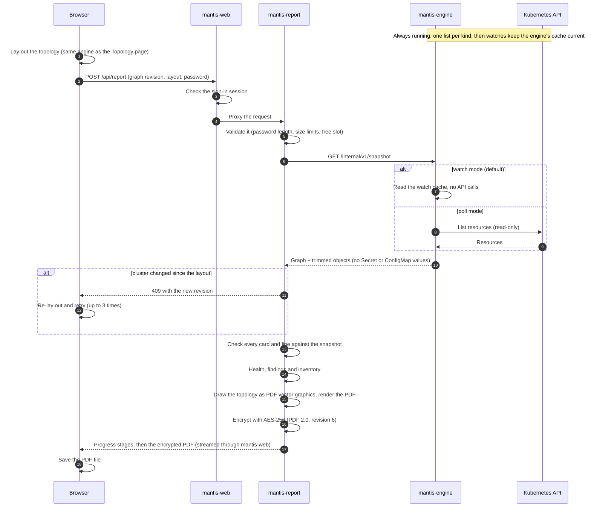

# Architecture

Mantis runs as **three independent services** in your cluster, plus your
browser as the client: `mantis-web`, `mantis-engine` and `mantis-report`.
There is no database and no separate storage — every graph you see is built
from the engine's live view of the Kubernetes API.

## The three services

**`mantis-engine` (backend)** is the only service that talks to Kubernetes.
On startup it builds a client using its Pod's ServiceAccount token (the
standard in-cluster config); outside a cluster it falls back to your local
kubeconfig, so the exact same binary works as a deployed service or as a
local dev tool. It exposes:

- `GET /api/graph` — the whole cluster, as JSON (or, with `?since=<revision>`,
  only what changed — see [the graph architecture page](graph-architecture.md))
- `GET /api/graph/search`, `GET /api/graph/neighbors` — indexed search and
  dependency-neighbourhood queries
- `GET /api/resource` — one resource's YAML manifest, fetched on demand
- `GET /internal/v1/snapshot` — the graph plus trimmed, value-free resource
  objects, for `mantis-report` only (not proxied by `mantis-web`)
- `GET /healthz`, `GET /readyz` — liveness/readiness probes

It renders no UI and generates no reports.

**`mantis-web` (frontend)** serves the embedded single-page UI and
reverse-proxies every `/api/*` request straight through to `mantis-engine`.
Your browser only ever talks to `mantis-web`; it never makes a direct
request to the engine or to the Kubernetes API. This is also what lets
`mantis-engine` stay a private `ClusterIP` service with no public exposure
at all — only `mantis-web` needs an Ingress or LoadBalancer. The one
exception to "everything goes to the engine" is `POST /api/report`, which
`mantis-web` proxies to `mantis-report`.

**`mantis-report` (reports)** generates the password-protected
[Infrastructure Report](reports.md) PDFs. It never talks to Kubernetes: it
reads one snapshot from the engine's internal API per report, checks the
browser's topology layout against it, renders the PDF and encrypts it with
AES-256. It is stateless — nothing about a report outlives the request — so
it scales independently of the engine (`report.replicaCount`), and its Pod
mounts no ServiceAccount token. Network policies allow only
`mantis-web → mantis-report → mantis-engine`.

## What happens on a page load

1. You open the Mantis URL. `mantis-web` checks for a valid session cookie;
   if you don't have one, you're redirected to `/login`.
2. After signing in, the browser loads the single-page app (one HTML
   document with its JS/CSS inlined — no separate asset requests, no CDN).
3. The page calls `GET /api/graph`. `mantis-web` proxies this straight to
   `mantis-engine`.
4. `mantis-engine` already has the graph. At startup it listed each
   resource kind it understands once (see
   [Core Concepts](core-concepts.md#resource-kinds)), then keeps an
   in-memory cache current with a Kubernetes `watch` per kind. When changes
   arrive it rebuilds the graph from that cache, with no API calls,
   resolving relationships (owner references, selectors, endpoint slices,
   volume/env references, …) and publishing a new revision. See
   [the graph architecture](graph-architecture.md#keeping-the-graph-current-watch-not-poll).
5. The graph is returned as JSON (gzip-compressed). The browser never sees
   raw Kubernetes objects for the graph — only the derived nodes, typed
   edges and the compact attributes the engine computed (readiness, image,
   probes, resource requests, …).
6. The UI projects the graph into the view you chose and lays it out
   deterministically, in the browser: no physics, no drift, no overlaps.
7. Every refresh interval (10 seconds by default, or manual) the browser
   asks for `GET /api/graph?since=<revision>` and receives only what
   changed.
8. If you open a resource's **YAML** tab, *that* triggers a single
   on-demand `GET /api/resource?kind=...&name=...&ns=...` — the engine
   fetches that one object fresh from the Kubernetes API (via the dynamic
   client, so this also covers CRDs), strips `managedFields`, and returns it.
   Secrets are refused outright.
9. **Download report** sends the browser's topology layout to
   `POST /api/report`; `mantis-web` proxies it to `mantis-report`, which
   reads one snapshot from the engine, checks the layout against it, and
   streams progress and then the encrypted PDF back. See
   [Infrastructure Reports](reports.md).

## How a report is generated

The password exists only inside that one request; the unencrypted PDF is
never written to disk. Details: [Infrastructure Reports](reports.md).

## RBAC: what the engine's ServiceAccount needs

`mantis-engine`'s ServiceAccount needs **read-only** (`get`/`list`/`watch`) access
to the resource kinds it maps — core workloads, networking, storage,
autoscaling objects, Nodes, and (best-effort, only if installed)
VerticalPodAutoscaler and Karpenter NodePool custom resources. It needs no
write verbs on anything, ever — there is no code path in Mantis that issues
a `create`, `update`, `patch`, or `delete` call.

If a `list` for some kind fails with a Forbidden error (RBAC denies it),
Mantis doesn't error out the whole graph: it silently omits that kind and
the graph reflects only what the ServiceAccount could actually read.
Mantis's own visibility is a direct, honest reflection of the permissions
it was granted — nothing more.

The [Helm chart](https://github.com/continuumx1/mantis/tree/main/charts/mantis)
templates exactly this ClusterRole (`charts/mantis/templates/rbac.yaml`) —
every rule in it is commented with the specific Go call that needs it, so
it doubles as a readable audit of what "read-only" actually means here.
