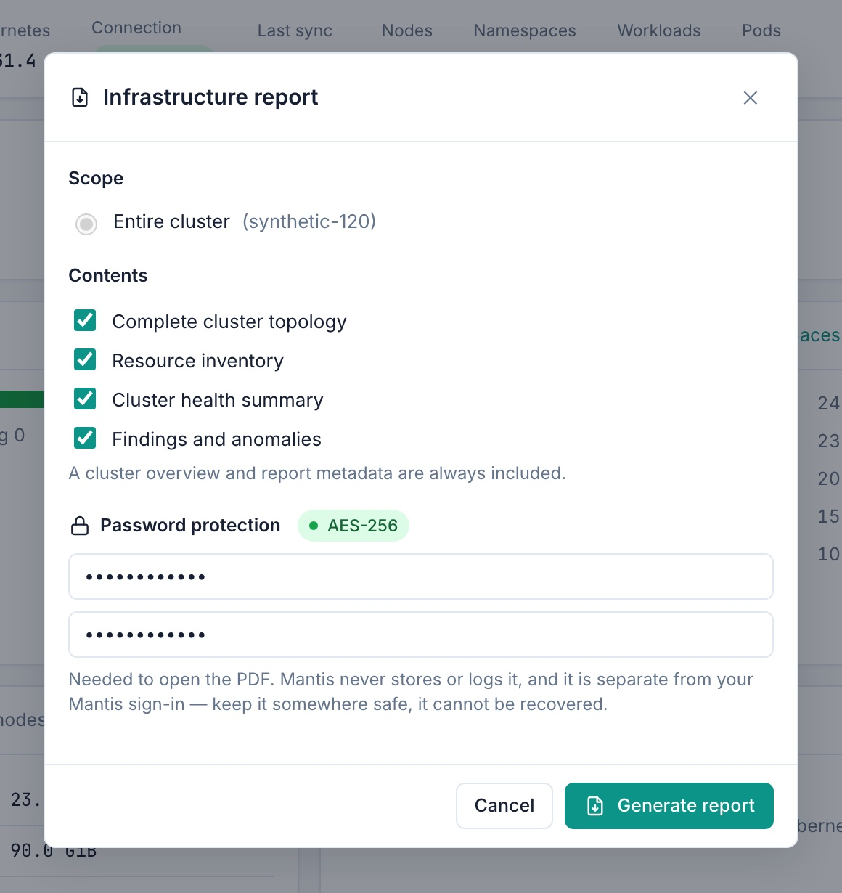
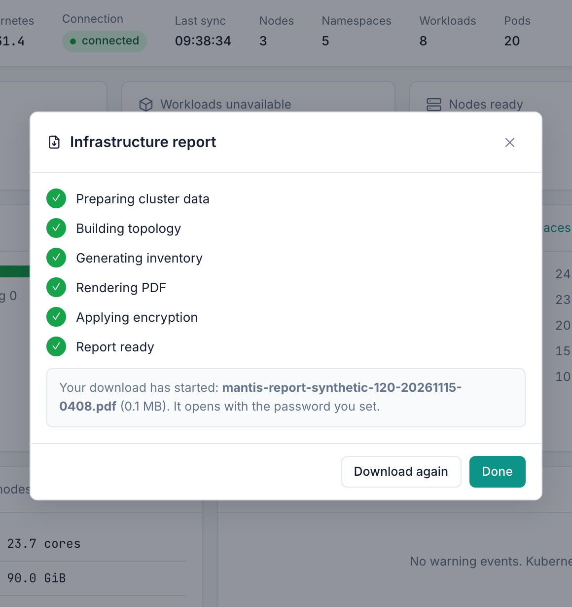
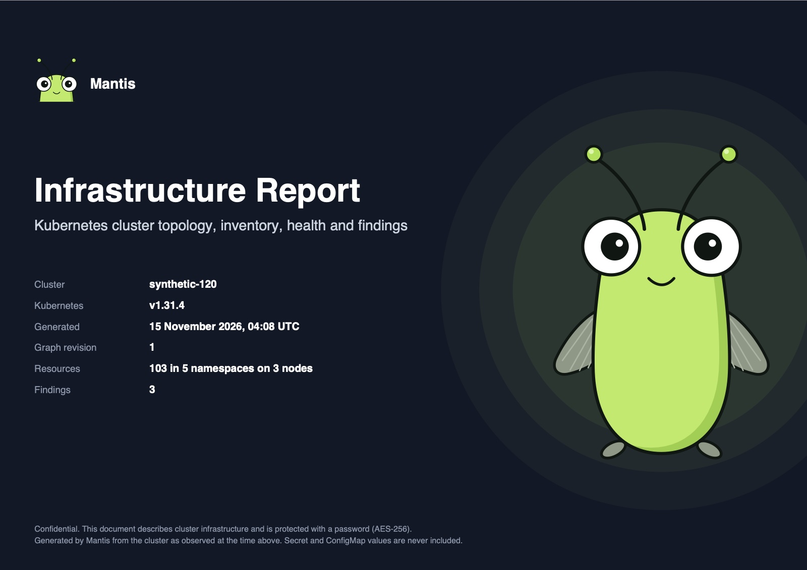
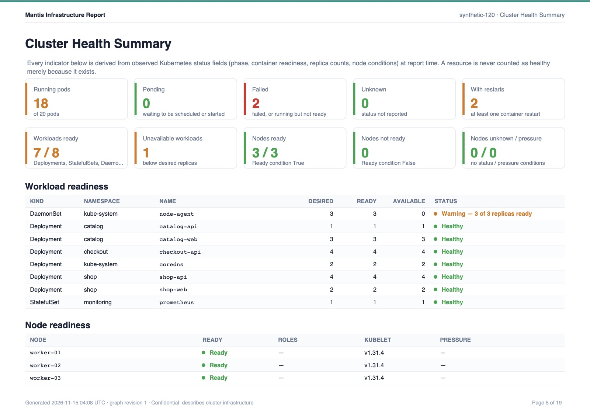
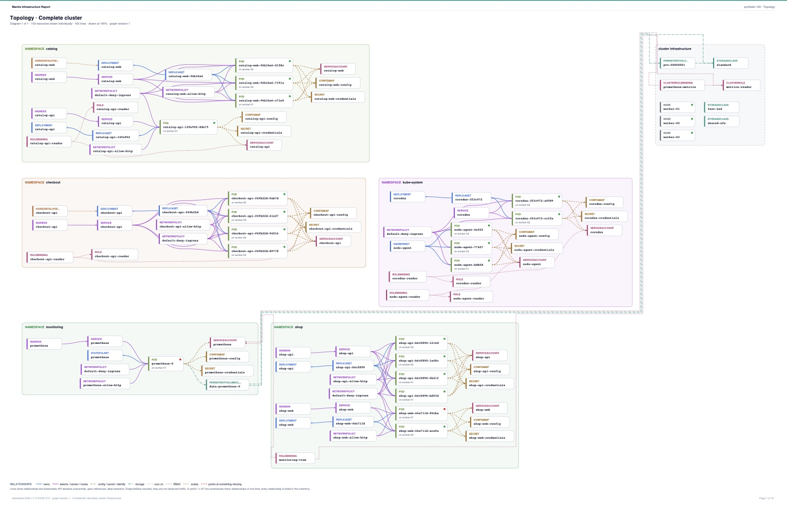
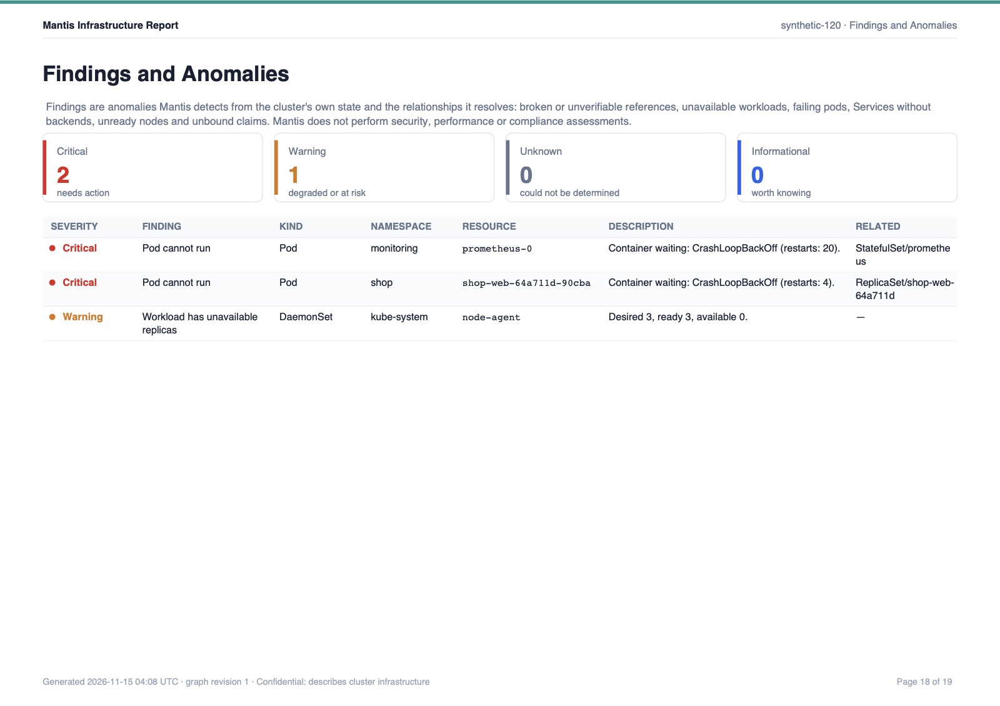
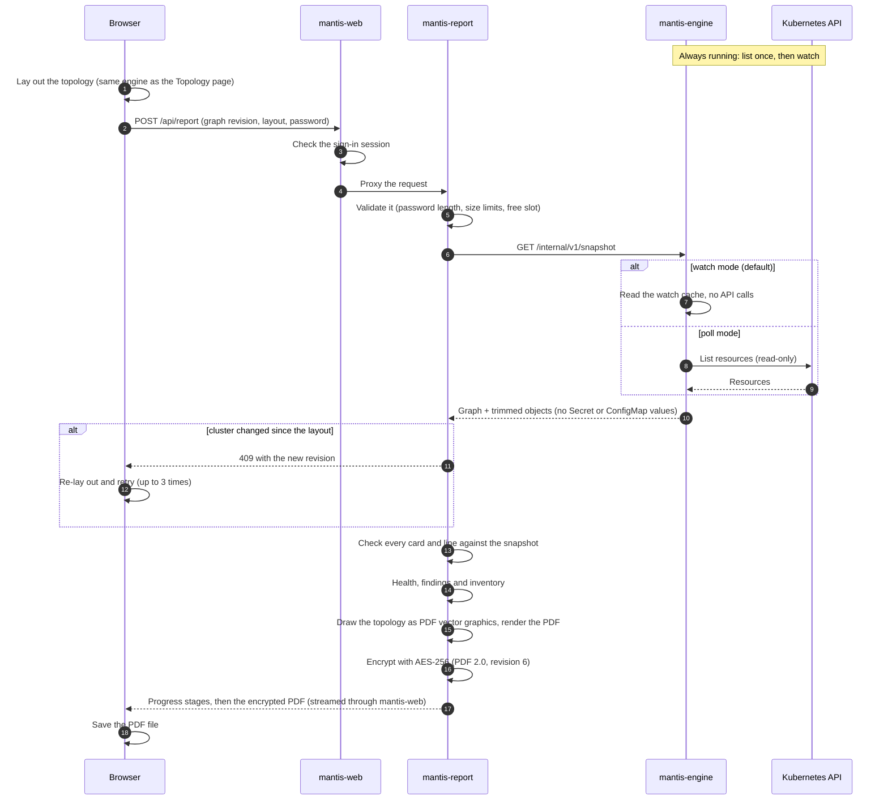

# Infrastructure Reports

Mantis can export the cluster it is showing as a password-protected PDF: a
point-in-time **Infrastructure Report** you can archive, attach to a change
review or hand to someone without Mantis access.

Open it from **Download report…** in the user menu, the **Download report**
button on the dashboard, or **Report** in the Topology toolbar. Choose the
contents, set a password, and the encrypted PDF downloads when every stage
is done:

{ width="330" }
{ width="330" }

Pages from a report generated from a sample cluster:

| Cover | Health summary | Topology | Findings |
|---|---|---|---|
|  |  |  |  |

## What the report contains

| Section | Content |
|---|---|
| Cover | Cluster/context, generation time, graph revision, sync mode, resource count |
| Contents | Clickable table of contents (also exported as PDF bookmarks) |
| Overview | Resource totals, namespaces, nodes, workloads, relationship counts |
| Health | Healthy / warning / critical / unknown breakdown per kind, derived from observed state |
| Topology | The relationship diagram, drawn as vector graphics (see below) |
| Inventory | Per-namespace summary, workloads, pods, networking, storage and configuration, cluster-scoped resources |
| Findings | Broken or unverified references, unavailable workloads, failing/pending/restarting pods, services selecting no pods, node pressure, pending/lost claims, kinds Mantis was not allowed to read — sorted by severity |
| Metadata | Snapshot details and what the report deliberately leaves out |

Every page carries a header and "Page N of M".

### Topology pages

The diagrams use the same deterministic, overlap-free layout as the Topology
page. Page size follows the diagram: a small cluster fits one A4-landscape
page; a bigger one gets a larger page so nothing is shrunk to illegibility.
When a single diagram would exceed 600 cards or the PDF page-size limit, the
report switches to a **cluster overview by namespace** plus **one diagram per
namespace**, with references to the namespaces each one connects to. Very
large namespaces keep big fan-outs folded ("48 Pods") on the diagram; the
inventory still lists every resource.

## Password protection

A password is **required** (8–256 characters). The PDF is encrypted with
AES-256 using the PDF 2.0 standard security handler (revision 6). The owner
password is random and discarded, so the protection can't be lifted without
the user password; printing is allowed, editing is not.

The password is used only to encrypt the document within that one request.
It is never stored, logged, or returned, and the unencrypted document is
never written to disk.

## What a report never contains

- **Secret values.** Secrets appear by name, type and how many pods use
  them.
  The engine does not send their data to `mantis-report`, and
  `mantis-report` clears it again on arrival.
- **ConfigMap values.** Only the key names are included.
- Container environment values, managed fields and
  `last-applied-configuration` annotations.

## How it works

Reports are generated by **`mantis-report`**, a separate, stateless service
(see [Architecture](architecture.md#the-three-services)):

1. The browser lays out the topology diagrams with the same engine the
   Topology page uses and sends only resource IDs and coordinates, plus the
   graph revision it laid out, to `POST /api/report` on `mantis-web`.
2. `mantis-web` checks the session and proxies the request to
   `mantis-report`.
3. `mantis-report` fetches a snapshot from `mantis-engine`'s internal API
   (`GET /internal/v1/snapshot`). That snapshot holds the graph and the
   trimmed objects the engine already has cached, so `mantis-report` never
   talks to Kubernetes itself. If the cluster changed since the browser's
   layout, it answers `409` and the browser re-lays out and retries.
4. Every resource and relationship on the diagrams is checked against that
   snapshot, so a request cannot put anything on a report that the cluster
   doesn't contain. Health, findings and inventory are computed from the
   snapshot itself.
5. Progress is streamed back as newline-delimited JSON (building topology,
   rendering topology, generating inventory, rendering PDF, encrypting,
   ready), so the dialog shows real stages. Cancelling the dialog aborts the
   request, and the server stops the work.

### Scaling and limits

`mantis-report` keeps no state between requests, so any replica can serve
any report. Each replica runs at most `MANTIS_REPORT_MAX_CONCURRENT` reports
at once (default 2) and answers `429` beyond that. A request is limited to
500 topology pages and 120,000 diagram cards.

| Env var | Default | Meaning |
|---|---|---|
| `MANTIS_REPORT_ADDR` | `:8080` | listen address |
| `MANTIS_ENGINE_URL` | `http://mantis-engine:8080` | engine base URL for snapshots |
| `MANTIS_REPORT_MAX_CONCURRENT` | `2` | simultaneous reports per replica |

In the Helm chart, `report.enabled` (default `true`) deploys the service and
points `mantis-web` at it. With it disabled, the report buttons return a
clear "Reports are not available" message.

## Current limitations

- Gateway API resources aren't covered yet, the same as the rest of Mantis.
- A report reflects the engine's snapshot when generation starts, not a
  continuous view.
